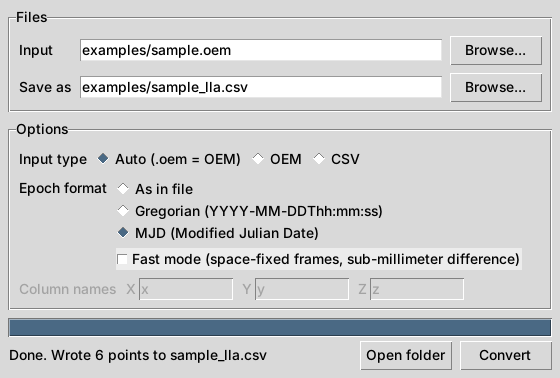

# Coordinate Converter

Converts satellite and ground positions from Earth-centered X/Y/Z coordinates to
latitude, longitude, and altitude (WGS84). Works from a desktop app or the command line,
and handles millions of points by processing files in chunks.



## What it does

- **ECEF CSV to lat/lon/alt.** Any CSV with X, Y, Z columns in meters.
- **CCSDS OEM orbit files.** Reads the text (KVN) format of the Orbit Ephemeris Message
  standard used by NASA and other space agencies, including multi-segment files.
- **Space-fixed frames.** Positions in EME2000/J2000, GCRF, ICRF, or TEME are rotated to
  Earth-fixed (ITRS) at each epoch using the IAU 2006/2000A model through astropy.
  An optional fast mode interpolates the slow precession-nutation terms for about an
  8x speedup with under 0.05 mm difference.
- **Epoch output formats.** Write epochs as they appear in the file, as Gregorian calendar
  dates, or as Modified Julian Dates (MJD). Day-of-year epochs such as `2026-292T12:00:00`
  are converted to calendar dates. MJD is computed from whole days plus a rounded fraction,
  so it keeps 12 decimal places (about 0.1 microsecond) without floating-point loss.
- **Clear errors.** Bad input points to the exact line and problem, such as an impossible
  date or a missing META field.

## Install

Python 3.9 or newer.

```
pip install -r requirements.txt
```

`astropy` is only needed for OEM files in a space-fixed frame.

On Linux, the desktop app also needs Tkinter: `sudo apt install python3-tk`
(it comes with Python on Windows and macOS).

## Desktop app

```
python converter_gui.py
```

1. Click **Browse** and pick a `.oem`, `.txt`, or `.csv` file.
2. For OEM files, choose an epoch format: as in file, Gregorian, or MJD.
3. For CSV files, enter the X, Y, Z column names if they are not `x`, `y`, `z`.
4. Click **Convert**. The output is saved next to the input as `<name>_lla.csv` unless you pick another location.

## Command line

```
python xyz_to_lla.py examples/sample.csv output.csv
python xyz_to_lla.py examples/sample.oem output.csv
python xyz_to_lla.py examples/sample.oem output.csv --time-format mjd
python xyz_to_lla.py examples/sample.oem output.csv --time-format gregorian --fast
```

| Option | Meaning |
| --- | --- |
| `--format auto\|csv\|oem` | Input type. Auto treats `.oem` files as OEM, everything else as CSV. |
| `--x`, `--y`, `--z` | CSV column names (default `x`, `y`, `z`). |
| `--time-format original\|gregorian\|mjd` | OEM only. How the epoch column is written. |
| `--fast` | OEM space-fixed frames only. Interpolated precession-nutation. |
| `--chunksize N` | Rows processed at a time. |

## Output

CSV input keeps all original columns and adds `lat`, `lon`, `alt`.

OEM input produces:

```
object, epoch, time_system, x_ecef_m, y_ecef_m, z_ecef_m, lat, lon, alt
```

With `--time-format mjd` the epoch column is named `epoch_mjd`. The time system is never
changed: a TDB epoch stays TDB, and the `time_system` column says which one it is.

Latitude and longitude are in degrees. Altitude is height above the WGS84 ellipsoid in meters.

## Use in your own code

```python
from xyz_to_lla import xyz_to_lla
lat, lon, alt = xyz_to_lla(x_array, y_array, z_array)
```

## Supported OEM metadata

| Field | Supported values |
| --- | --- |
| `CENTER_NAME` | EARTH |
| `REF_FRAME` | ITRF, any ITRF*, EFG, ECEF, EME2000, J2000, GCRF, ICRF, TEME |
| `TIME_SYSTEM` | UTC, TAI, TT, TDB, TCG, TCB, UT1, GPS |
| Epochs | `YYYY-MM-DDThh:mm:ss.sss` or `YYYY-DDDThh:mm:ss.sss` |

Covariance blocks are skipped. The XML version of OEM is not supported.

## Built with

Python, NumPy, pandas, pyproj (PROJ), astropy / ERFA, Tkinter.
